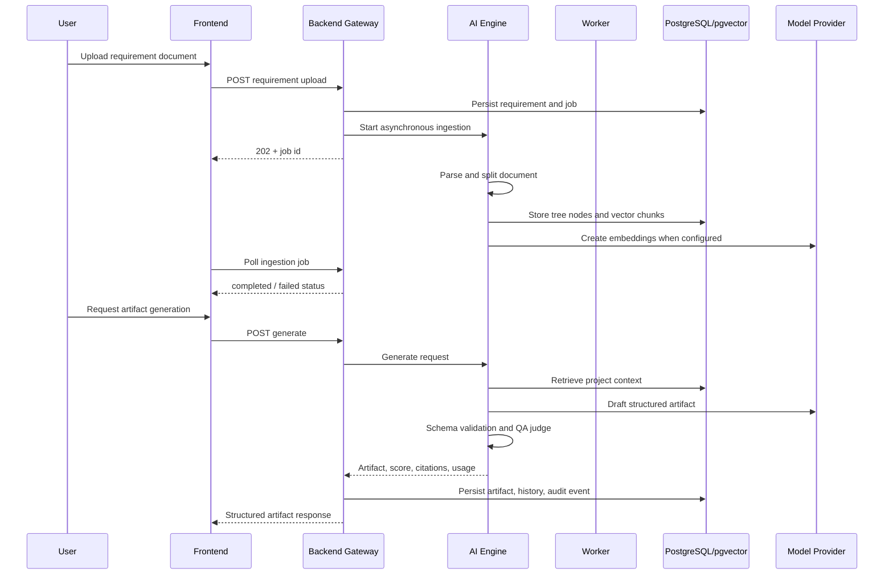
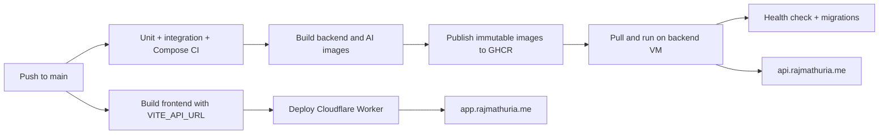

# SprintSmith Project Overview

## 1. What SprintSmith Is

SprintSmith is an AI-assisted software delivery platform. A user provides requirements or project documents, and the system can:

- authenticate users and manage projects;
- ingest DOCX, PDF, and text requirements;
- retrieve relevant context using hybrid RAG;
- use a knowledge-tree and vector search together;
- generate structured SDLC artifacts such as user stories, API specifications, test cases, architecture documents, and sprint plans;
- validate generated output against schemas and quality rules;
- expose citations, traceability, evaluation data, and generation telemetry;
- run through Docker locally and CI/CD in GitHub Actions.

The repository is a monorepo. The frontend and backend are separated by service boundaries while shared deployment and CI/CD remain in the root repository.

## 2. High-Level Architecture

```mermaid
flowchart LR
    User[User / Frontend] -->|HTTPS JSON/SSE| Backend[Backend Gateway\nFastAPI :8002]
    Backend --> Auth[Authentication + RBAC]
    Backend --> DB[(PostgreSQL)]
    Backend --> Engine[AI Engine\nFastAPI :8001]
    Engine --> Parser[Document Parser]
    Engine --> Tree[Knowledge Tree]
    Engine --> Vector[PGVector]
    Engine --> LLM[Groq / Gemini / fallback provider]
    Backend --> Files[Upload Storage]
    Worker[Async Worker] --> DB
    Worker --> Files
    Worker --> Graph[Entities + relationships]
    API[Platform API :8000] --> DB
    Prom[Prometheus] --> API
    Grafana[Grafana] --> Prom
```



### Main services

| Service | Local port | Responsibility |
| --- | ---: | --- |
| Frontend | Vite-selected port | Browser UI and user workflows |
| `backend-core` | `8002` | Product API: auth, projects, requirements, artifacts, generation, evaluation, exports, audit |
| `ai-engine` | `8001` | Ingestion, retrieval, generation, evaluation, prompts, and model routing |
| Platform API | `8000` | SprintSmith platform health, basic document/search contracts, and platform worker boundary |
| Worker | internal | Background document processing and graph extraction |
| PostgreSQL/pgvector | `5433` host | Relational data, chunks, vector storage, and graph tables |
| Prometheus | `9090` | Metrics collection |
| Grafana | `3000` | Dashboards and operational visibility |

The integrated backend gateway is the main frontend API. The AI engine is an internal service and should not be called directly from the browser.

## 3. Repository Map

```text
apps/api/                         Lightweight SprintSmith platform API
apps/worker/                      Background ingestion worker
backend-core/backend/             Main product backend gateway
backend-core/ai-engine/           RAG and generation engine
frontend/                         TanStack Start + React frontend
infra/db/                         PostgreSQL initialization/schema
infra/docker/                     Platform Dockerfiles
infra/deploy/                     Production VM Compose and env template
infra/observability/              Prometheus/Grafana configuration
docs/frontend-api.md              Frontend endpoint contract
docs/deployment.md                Production hosting and deployment guide
.github/workflows/                Root CI/CD workflows
compose.yaml                      Local multi-service stack
Makefile                          Common developer commands
```

## 4. End-to-End User Flow



## 5. RAG: What It Means Here

RAG means Retrieval-Augmented Generation.

Instead of asking an LLM to answer only from its training data, SprintSmith first retrieves relevant project-specific context and supplies that context to the generation model.

```text
User requirement
      |
      v
Retrieve relevant project context
      |
      v
Build a grounded prompt
      |
      v
LLM creates structured output
      |
      v
Validate, score, retry if necessary
      |
      v
Return artifact with telemetry and provenance
```

This reduces unsupported answers and lets the system use private project documents without training the model on them.

## 6. Document Ingestion Pipeline

The AI engine uses one parse to create two related representations:

1. A hierarchical knowledge tree.
2. Child chunks for vector retrieval.

This relationship is important: every vector chunk carries the `node_id` of the tree section from which it was created.

### Ingestion steps

1. Receive an asynchronous ingestion request.
2. Load the source document using the configured parser.
3. Extract text, headings, tables, and page metadata where available.
4. Normalize the extracted blocks.
5. Build parent and child tree nodes.
6. Split node text into overlapping chunks.
7. Attach metadata such as project ID, document ID, node ID, title, source, and page range.
8. Create embeddings using the configured embedding provider.
9. Store chunks in PGVector.
10. Return job status, content hash, chunk count, and tree-node information.

The worker also supports the platform's lightweight local path by extracting text from DOCX/text files, storing chunks in PostgreSQL full-text search, and creating basic entity relationships.

## 7. Knowledge Graph / Knowledge Tree

There are two related graph concepts:

### Document knowledge tree

This is the structural hierarchy of a document:

```text
Requirement document
  ├── Authentication
  │     ├── Login
  │     └── Password reset
  └── Reporting
        ├── Export
        └── Audit history
```

The tree is useful because retrieval can select a meaningful section instead of returning disconnected text fragments.

### Entity relationship graph

The platform worker extracts simple named entities and stores relationships such as:

```text
Cloudflare --co_occurs_with--> DNS
DNS        --co_occurs_with--> PostgreSQL
```

These relationships have provenance through the source chunk. Later, this can be extended with stronger entity resolution, typed predicates, confidence scoring, and graph traversal.

## 8. Hybrid Retrieval

Hybrid retrieval combines multiple retrieval signals:

- **Vector leg:** semantic similarity using embeddings and PGVector.
- **Tree leg:** selects relevant document sections using the knowledge tree and a selector model.
- **Fusion:** combines rankings with Reciprocal Rank Fusion (RRF).

RRF uses this basic formula:

```text
score(item) = sum(1 / (k + rank))
```

The implementation uses a default `k = 60`.

### Retrieval behavior

- Both retrieval legs start concurrently.
- Vector retrieval has a hard timeout. If it fails, retrieval raises an error rather than silently returning empty context.
- Tree retrieval has a soft timeout. If it fails, times out, or selects nothing, the system degrades to vector-only retrieval.
- Duplicate sections are collapsed by `node_id`.
- Results retain source, title, page range, score, and retrieval-leg provenance.
- Results are cut to a context token budget before generation.

This is more reliable than using only keyword search or only vector similarity.

## 9. Generation Pipeline

The AI engine uses a LangGraph state graph:

```text
retrieve
   |
   v
PM draft
   |
   v
QA schema validation + LLM judge
   |
   +---- score >= 0.80 ----> finalize
   |
   +---- score < 0.80 ------> revise draft, maximum two retries
```

### Generation stages

1. **Retrieve:** retrieve context exactly once for the generation request.
2. **PM draft:** send the requirement, context, schema instructions, and repair notes to the selected model.
3. **Schema validation:** parse the result into the selected artifact schema.
4. **LLM judge:** score faithfulness, completeness, and artifact quality.
5. **Revision:** if the score is below the approval threshold, send the critique back to the draft step.
6. **Finalize:** accept the approved artifact or the best available artifact after retry exhaustion.

The response can include:

- generated structured output;
- model used;
- prompt version;
- evaluation score;
- retry count;
- token usage;
- latency;
- retrieval trace and citations.

Provider routing is adapter-based. Groq is intended for fast generation, Gemini is used for embeddings/fallback behavior, and local or other providers can be added behind the provider layer.

## 10. Backend API Responsibilities

The frontend should call `backend-core`:

- authentication: register, login, current user;
- projects: create, list, update, delete, members;
- requirements: upload, list, inspect, poll ingestion;
- generation: generate, stream, compare models;
- artifacts: list, inspect, edit, export;
- evaluations: submit and list quality feedback;
- history and traceability: inspect generation history and graph edges;
- administration: audit logs and batch evaluation.

The complete endpoint list is in [docs/frontend-api.md](docs/frontend-api.md).
Swagger locations:

```text
Local integrated backend: http://localhost:8002/docs
Production backend:      https://api.rajmathuria.me/docs
```

## 11. Observability

### Logs

Services emit structured request/service logs. Use:

```bash
docker compose --profile core logs -f --tail=100
```

Do not log secrets, raw documents, unrestricted prompts, or sensitive user data.

### Metrics

Prometheus collects API request counters and latency histograms from `/metrics`.
Important production metrics should include:

- request rate and error rate;
- p95/p99 latency;
- ingestion job count and failure count;
- retrieval latency and fallback count;
- vector/tree hit counts;
- token usage and estimated model cost;
- queue depth;
- database health;
- citation and evaluation scores.

Grafana visualizes the metrics through the provisioned dashboard.

## 12. CI/CD

### Pull request and main CI

Root workflows validate:

- Python dependency installation;
- Ruff linting;
- root unit tests;
- Compose syntax;
- full-stack smoke checks.

Backend-core CI validates:

- backend unit/integration/contract tests;
- PostgreSQL migrations;
- repository and API integration tests.

AI-engine CI validates:

- offline retrieval, ingestion, generation, and evaluation tests;
- dependency/model caching;
- no live model credentials required for the offline suite.

### Production deployment flow



Backend deployment is currently opt-in through the production variable:

```text
BACKEND_DEPLOY_ENABLED=true
```

Frontend deployment can run independently.

## 13. Deployment Topology

- Cloudflare hosts the frontend Worker and handles frontend custom domains.
- A Docker-capable VM hosts PostgreSQL/pgvector, backend-core, and AI engine.
- Cloudflare DNS maps `api.rajmathuria.me` to the backend VM.
- The frontend uses `VITE_API_URL=https://api.rajmathuria.me`.
- The existing `portfolio.rajmathuria.me` site should remain unchanged.

The exact setup is documented in [docs/deployment.md](docs/deployment.md).

## 14. How To Explain The Project In One Minute

SprintSmith converts software requirements into structured engineering artifacts. The backend receives documents and user requests, the ingestion pipeline parses documents into a knowledge tree and vector chunks, hybrid retrieval finds grounded context, and a LangGraph generation workflow drafts and validates artifacts with an LLM judge. The backend persists users, projects, requirements, artifacts, evaluations, and audit records. Docker provides reproducible services, Prometheus and Grafana provide observability, GitHub Actions tests and publishes images, Cloudflare hosts the frontend, and a Docker VM hosts the stateful backend and AI services.

## 15. Current Boundaries

The platform is production-shaped, but these areas still need deliberate production hardening:

- backend VM provisioning and backups;
- authentication hardening and secret rotation;
- model-provider quotas and cost controls;
- database backup/restore drills;
- stronger entity resolution and graph semantics;
- retrieval benchmark thresholds;
- rate limits and data-retention policies;
- Cloudflare custom-domain attachment;
- public API deployment verification.
